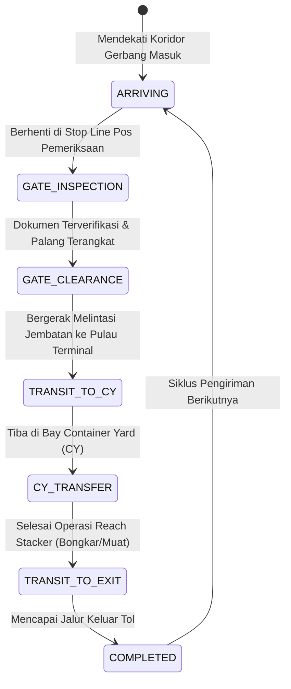
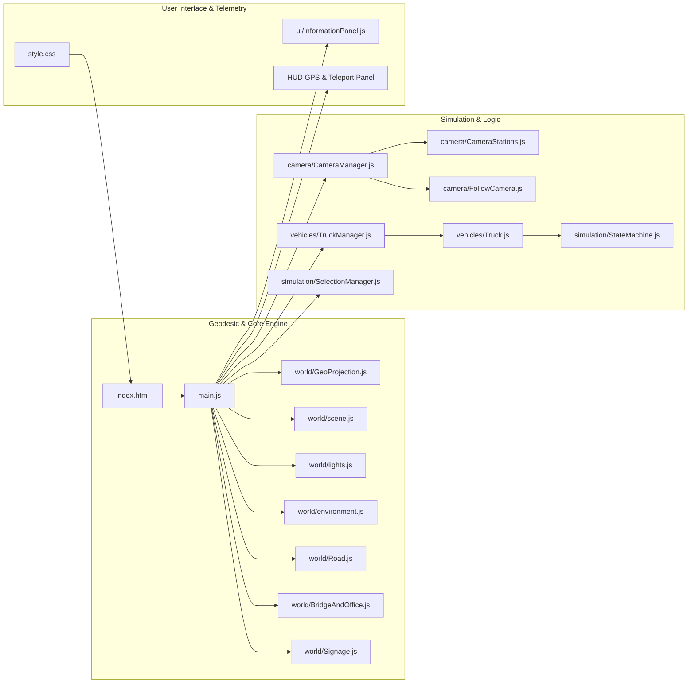

# 🏗️ Terminal Teluk Lamong (TTL) 3D Operation & Corridor Simulator

[](https://threejs.org/)
[](https://vitejs.dev/)
[](https://developer.mozilla.org/)
[](LICENSE)
[]()

---

## 📑 Daftar Isi
1. [Definisi Proyek](#1-definisi-proyek)
2. [Tujuan Proyek](#2-tujuan-proyek)
3. [Stack Teknologi](#3-stack-teknologi)
4. [Alur dan Arsitektur Sistem (Flow)](#4-alur-dan-arsitektur-sistem-flow)
   - [4.1 Alur Logistik & Operasional Lapangan](#41-alur-logistik--operasional-lapangan)
   - [4.2 Siklus Hidup Truk (State Machine)](#42-siklus-hidup-truk-state-machine)
   - [4.3 Arsitektur Teknis Sistem](#43-arsitektur-teknis-sistem)
5. [Hasil dan Fitur yang Dibangun](#5-hasil-dan-fitur-yang-dibangun)
6. [Struktur Direktori](#6-struktur-direktori)
7. [Cara Penggunaan](#7-cara-penggunaan)
   - [Prasyarat](#prasyarat)
   - [Instalasi](#instalasi)
   - [Menjalankan Aplikasi](#menjalankan-aplikasi)
   - [Panduan Kontrol Navigasi](#panduan-kontrol-navigasi)

---

## 1. Definisi Proyek

**Terminal Teluk Lamong (TTL) 3D Operation & Corridor Simulator** adalah aplikasi simulasi web 3D interaktif berbasis WebGL dan Three.js yang merepresentasikan koridor akses operasional dan infrastruktur **Terminal Teluk Lamong (PT Pelindo)** di Surabaya, Jawa Timur, Indonesia berdasarkan kalibrasi koordinat geografis nyata (WGS84 GPS Apple Maps & Google Maps).

Terminal Teluk Lamong dikenal sebagai pelabuhan berkonsep *green and smart port* semi-otomatis pertama di Indonesia dengan letak terminal lepas pantai (*offshore terminal*) yang dihubungkan melalui jalan layang/jembatan penghubung laut (*causeway bridge*) dari daratan utama (*mainland*).

Simulator ini memodelkan secara presisi:
- **Gerbang Akses Daratan Tambak Osowilangon ($Z = -1108$)**: Jalan darat masuk dan keluar masing-masing 3 lajur terdedikasi simetris (Lebar 12.0m per arah: Lajur Kontainer, Lajur Curah Kering, Lajur Kendaraan Pribadi/Operasional) dengan aturan lalu lintas kiri Indonesia (*Left-Hand Traffic*).
- **Interchange Flyover Tol Romokalisari ($Z \in [-1108, -792]$)**: Jalan tol layang kembar 2 lajur per arah yang sudah melayang tinggi ($Y = 7.0\text{m}$) di antara jalur darat Osowilangon, lalu melandai turun (**ramp down**) sepanjang 316 meter ke level tanah di $Z = -792$, didukung struktur *box girder*, parapet penahan benturan, pilar silinder maritim, serta jalan kolong *underpass* dengan *yellow box junction*.
- **Penyempitan Simetris & Titik Penggabungan ($Z \in [-792, -680]$)**: Kanalisasi marka chevron *gore* di mana arus tol dan darat menyatu secara tertib, menyempit dari koridor lebar 48 meter menjadi 32 meter terdedikasi (3 lajur masuk + 8m median hijau + 3 lajur keluar).
- **Pos Pemeriksaan Keamanan (*Security Checkpoint*, $Z = -186$)**: Kanopi baja megah menaungi 3 lajur masuk, gardu inspeksi petugas, *speed bumps*, dan *water barriers*.
- **Sistem Kalibrasi Geodesik Nyata (*GeoProjection*)**: Pemetaan koordinat metrik 3D 1:1 ke WGS84 Latitude & Longitude nyata dengan bearing koridor $57.55^\circ$, HUD telemetri live, dan fitur teleportasi Google Maps.
- **Ekosistem Pesisir**: Tambak perikanan (*aquaculture ponds*), tanggul tanah, estuari berlumpur intertidal, dan vegetasi bakau (*mangrove*).
- **Jembatan Laut Penghubung (*Sea Causeway Bridge*)**: Jalur layang 6 lajur dengan pilar pancang bawah air, pipa konveyor tertutup curah kering (*enclosed dry-bulk conveyor pipeline*), dan penerangan jalan ganda.
- **Kompleks Pulau Perkantoran (*Pulau 1 - Administrative & Operational Complex*)**: Gedung Graha Pelindo 4 lantai, kanopi drop-off, Masjid TTL berkubah putih, fasilitas olahraga & shelter parkir, area tunggu truk (*truck buffer holding yard*), serta gerbang tol inter-island 10 gardu dengan kanopi *barrel-vault* 50 meter.
- **Mesin Operasional**: Simulasi interaksi alat berat petikemas (*Reach Stacker*), truk semi-trailer setir kanan (*Right-Hand Drive*), serta panel kendali observasi interaktif (*Head-Up Display*).

---

## 2. Tujuan Proyek

Proyek ini dibangun untuk memenuhi beberapa tujuan strategis:

1. **Digital Twin & Visualisasi 3D Interaktif Berbasis Koordinat Nyata**:
   Menghadirkan replika visual digital interaktif dari lanskap fisik dan alur logistik Terminal Teluk Lamong dengan skala metrik 1:1 dan koordinat GPS nyata yang dapat diakses langsung melalui peramban web modern tanpa instalasi perangkat lunak tambahan.
2. **Validasi Alur Lalu Lintas & Tata Letak (*Layout & Traffic Validation*)**:
   Mengevaluasi efektivitas sistem 3 lajur khusus terdedikasi dari dua gerbang akses (Tol Romokalisari & Tambak Osowilangon), kelancaran penggabungan arus (*merge*), kapasitas antrean di pos keamanan sebelum jembatan laut, serta pergerakan kendaraan di area buffer (*holding yard*).
3. **Media Edukasi, Pelatihan, & Presentasi Stakeholder**:
   Memberikan pemahaman komprehensif bagi operator pelabuhan, pengemudi armada logistik, dispatcher, dan mahasiswa magang mengenai zonasi pelabuhan, prosedur gerbang OCR, serta aspek keselamatan operasional.
4. **Dasar Pengembangan Sistem Simulasi Cerdas Terpadu**:
   Menjadi fondasi untuk mengintegrasikan data IoT pelabuhan secara *real-time* (seperti posisi GPS armada dari Google Maps / GPS Tracker, status gerbang otomatis, dan jadwal sandar kapal).

---

## 3. Stack Teknologi

| Komponen | Teknologi | Keterangan |
| :--- | :--- | :--- |
| **3D Graphics Engine** | [Three.js](https://threejs.org/) (`v0.185.1`) | Render grafis 3D WebGL, pencahayaan PBR, sistem bayangan *PCF Soft Shadows*, dan matriks kamera. |
| **Geodesic Engine & GPS** | WGS84 Geodesic Projection (`GeoProjection.js`) | Konversi dua arah koordinat GPS Apple/Google Maps ke 3D Cartesian meter, bearing $57.55^\circ$, dan telemetri live. |
| **Build Tool & Dev Server** | [Vite](https://vitejs.dev/) (`v8.2.0`) | Bundler modern berbasis ES Modules untuk *Fast HMR (Hot Module Replacement)* dan build produksi optimal. |
| **Programming Language** | JavaScript (ES6+ / ESM) | Logika modular untuk simulasi kendaraan, state machine, kalkulasi posisi waypoints, dan interaksi kanvas. |
| **Styling & HUD UI** | Vanilla CSS3 | Desain panel antarmuka *dark-mode glassmorphism*, tipografi sistematis, tata letak responsif, dan panel *collapsible*. |
| **Interactive Controls** | Three.js `OrbitControls` & Custom Input | Navigasi mouse orbit/pan/zoom dengan pembatasan sudut horizon (*ground clipping protection*) serta kontrol keyboard *WASD / QE / Zoom*. |
| **Procedural Generation** | HTML5 2D Canvas Context | Generator tekstur prosedural berbasis canvas untuk papan penunjuk arah kayu (*Entry/Exit signboards*), marka jalan, dan logo. |
| **Persistence** | Browser `sessionStorage` | Menyimpan sudut dan posisi kamera pengguna secara otomatis antar *reload* browser. |

---

## 4. Alur dan Arsitektur Sistem (Flow)


### 4.1 Alur Logistik & Operasional Lapangan

Alur pergerakan logistik kendaraan yang disimulasikan dari dua gerbang akses daratan hingga area operasional:

```mermaid
flowchart TD
    subgraph Gerbang Akses Daratan Selatan Z = -1108m
        A1[Akses Darat Jl. Raya Tambak Osowilangon<br>3 Lajur Darat Level Tanah Y = 0.81m]
        A2[Interchange Tol Romokalisari<br>Flyover Layang Kembar 2 Lajur Y = 7.00m]
    end

    A1 -->|Lajur Luar Masuk X: +13 s.d. +25| B1[3 Lajur Permukaan Tanah Osowilangon]
    A2 -->|Turun Melandai / Ramp Down 316m| B2[Flyover Layang Tol Romokalisari Y: 7m ke 0.81m]

    subgraph Titik Penggabungan & Penyempitan Z = -792m s.d. -680m
        B1 & B2 --> C[Touchdown Tol & Marka Chevron Gore]
        C --> D[Penyempitan Simetris: Lebar 48m Menjadi 32m]
    end

    subgraph Koridor Utama 3 Lajur Menuju Terminal Z = -680m s.d. -80m
        D --> E{Sistem 3 Lajur Khusus Terdedikasi}
        E -->|Lajur Luar X = +14.0| F[Truk Petikemas / Kontainer 20ft & 40ft]
        E -->|Lajur Tengah X = +10.0| G[Truk Curah Kering / Dump Truck]
        E -->|Lajur Sisi Median X = +6.0| H[Mobil Operasional & Sepeda Motor]
    end

    F & G & H --> I[Pos Pemeriksaan Keamanan Daratan Z = -186m]
    I --> J[Pengecekan Dokumen, Speed Bumps & Water Barriers]
    J --> K[Peralihan Abutmen Taper ke Jembatan Laut Z = -55m]
    K --> L[Elevated Causeway Bridge 6-Lajur Z: -55 s.d. +780m / 835m]
    L --> M[Pulau 1: Kompleks Kantor & Fasilitas Graha Pelindo]
    
    M --> N{Jenis Perjalanan Truk}
    N -->|Pemeriksaan OCR & Timbang| O[Main Gate & OCR Toll Plaza 10 Gardu]
    N -->|Antrean / Staging| P[Truck Buffer Holding Yard]
    
    O --> Q[Causeway Antar Pulau Z: 1080 - 1590]
    Q --> R[Offshore Terminal Island: CY Petikemas & Dermaga Curah/STS]
    R --> S[Bongkar Muat via Reach Stacker / ASC / STS Crane]
    S --> T[Jalur Keluar 3 Lajur Simetris Menuju Osowilangon & Tol Romokalisari]
```

#### Tabel Kalibrasi Titik Koordinat Nyata (WGS84 Ground Truth vs Sistem Metrik 3D)

Seluruh posisi koridor telah dikalibrasi secara presisi dengan citra satelit dan data GPS:

| Segmen Infrastruktur | WGS84 Latitude, Longitude | Posisi 3D ($X, Y, Z$) | Deskripsi Operasional |
| :--- | :--- | :--- | :--- |
| **Akses Masuk Tambak Osowilangon** | `-7.215009, 112.654051` s.d. `-7.215117, 112.654114` | $X \in [+13, +25]$, $Z = -1108$ | 3 lajur permukaan tanah ($12.0\text{m}$) dari Jl. Raya Tambak Osowilangon. |
| **Akses Keluar Tambak Osowilangon** | `-7.215370, 112.654230` s.d. `-7.215461, 112.654278` | $X \in [-25, -13]$, $Z = -1108$ | 3 lajur permukaan tanah ($12.0\text{m}$) menuju Jl. Raya Tambak Osowilangon. |
| **Awal Ramp Tol Masuk Romokalisari** | `-7.215120, 112.654114` s.d. `-7.215204, 112.654156` | $X \in [+4, +12]$, $Y = 7.0$, $Z = -1108$ | Flyover layang kembar 2 lajur, melayang di atas tanah, kolong bebas hambatan. |
| **Awal Ramp Tol Keluar Romokalisari** | `-7.215281, 112.654180` s.d. `-7.215358, 112.654221` | $X \in [-12, -4]$, $Y = 7.0$, $Z = -1108$ | Flyover layang kembar 2 lajur menuju interchange Tol Romokalisari. |
| **Titik Gabung Arus Masuk (*Merge In*)** | `-7.213705, 112.656569` s.d. `-7.213833, 112.656645` | $X \in [+4, +16]$, $Y = 0.81$, $Z = -792$ | Touchdown aspal flyover tol menyatu dengan jalur darat Osowilangon. |
| **Titik Gabung Arus Keluar (*Merge Out*)**| `-7.213904, 112.656685` s.d. `-7.214041, 112.656768` | $X \in [-16, -4]$, $Y = 0.81$, $Z = -792$ | Pemisahan arus keluar menuju jalan layang tol vs jalan arteri darat. |
| **Celah Median Pohon Tengah** | Terbentang menerus sepanjang koridor | $X \in [-4, +4]$ | Jalur hijau pohon peneduh & semak pemisah arah masuk dan keluar. |
| **Pos Pemeriksaan Keamanan Daratan** | `-7.211756, 112.659972` | $X = 0$, $Y = 0.81$, $Z = -186$ | Kanopi baja 3 lajur masuk, gardu inspeksi sekuriti, dan *speed bumps*. |
| **Pangkal Jembatan Laut (Abutmen Darat)**| `-7.211325, 112.660683` | $X = 0$, $Y = 2.0$, $Z = -55$ | Titik awal jembatan layang Causeway 1 di atas laut estuari. |
| **Ujung Jembatan Laut Causeway 1** | `-7.209969, 112.662662` s.d. `-7.210052, 112.662735` | $X \approx 0$, $Y = 3.5$, $Z = +780$ | Akhir jembatan sepanjang 835m sebelum persimpangan gerbang terminal Pulau 1. |


---

### 4.2 Siklus Hidup Truk (State Machine)

Kendaraan logistik dikendalikan oleh modul [StateMachine.js](file:///src/simulation/StateMachine.js) yang mengatur tahapan operasional secara otomatis:



---

### 4.3 Arsitektur Teknis Sistem



---

## 5. Hasil dan Fitur yang Dibangun

### A. Lingkungan 3D & Koridor Daratan (*Mainland to Causeway Island*)
- **Gerbang Akses Ganda Simetris Identik (Skala Metrik 1:1 Nyata)**:
  - **Akses Darat Tambak Osowilangon ($Z = -1108$)**: 3 lajur permukaan tanah per arah ($12.0\text{m}$ masuk, $12.0\text{m}$ keluar) dengan lajur terdedikasi (Kontainer, Curah Kering, Mobil/Motor).
  - **Interchange Flyover Tol Romokalisari ($Z \in [-1108, -792]$)**: Jalan tol layang kembar ($8.0\text{m}$ per dek) yang melayang tinggi ($Y = 7.0\text{m}$) di antara akses Osowilangon, lalu melandai turun (**ramp down**) sepanjang 316 meter hingga menyentuh tanah di $Z = -792$. Terdiri dari box girder beton padat, lapisan aspal tebal, concrete parapet crash barrier, pilar maritim silinder, serta jalan kolong *underpass* dengan *yellow box junction*. Bebas dari konflik truk/jalan di bawah kolong.
- **Titik Penggabungan & Penyempitan Simetris ($Z \in [-792, -680]$)**: Kanalisasi marka chevron *gore* di mana arus tol dan darat menyatu secara tertib, menyempit secara simetris dari lebar 48 meter menjadi 32 meter terdedikasi (3 lajur masuk + 8m median hijau + 3 lajur keluar).
- **Median Tengah Berpohon Konsisten**: Celah tengah 8.0 meter ($X \in [-4.0, +4.0]$) dipertahankan menerus dengan pohon rindang dan semak taman yang dikalibrasi bebas benturan struktur dek layang.
- **Pos Pemeriksaan Daratan (*Security Checkpoint*, $Z = -186$)**: Kanopi baja megah menaungi 3 lajur masuk, gardu inspeksi petugas, marka stop line aspal, *speed bumps*, dan *water barriers*.
- **Lanskap Pesisir Estuari**: Air tambak tenang, tanggul pematang tambak bertingkat, air laut estuari berpartikel silt dengan efek transparansi, serta barisan pohon bakau (*mangrove*).
- **Causeway Bridge Melengkung (835m)**: Tiang pancang beton maritim (*pile caps*), dek beton tebal 32m, pagar pengaman (*crash barrier*), dan pipa konveyor curah kering terisolasi di sisi timur, menghubungkan abutmen daratan ($Z = -55$) ke persimpangan terminal Pulau 1 ($Z \approx +780$).
- **Pulau 1 (Administrative & Operations)**:
  - Gedung **Graha Pelindo** modern 4 lantai dengan kaca reflektif, kanopi drop-off, tiang antena radio komunikasi, panel surya, serta logo berpendar.
  - **Masjid Terminal Teluk Lamong** dengan kubah putih monumental dan menara azan.
  - Lapangan olahraga (basket/futsal), taman lanskap palem, dan shelter kanopi parkir motor pegawai.
  - **Main Gate OCR**: Portal toll inspeksi berkanopi lebar dengan tiang baja dan rambu gantry.
  - **Truck Buffer Holding Yard**: Area parkir antrean truk dengan tumpukan petikemas multi-warna (*Evergreen, Maersk, CMA CGM, Hapag-Lloyd*).
  - **Inter-Island Toll Plaza**: Struktur kanopi melengkung *barrel-vault* sepanjang 50 meter dengan 10 gardu tol.

### B. Kontrol Kamera Multi-Vantage & Fleksibel
- **Preset Stasiun Pengamatan (*15+ Kamera Preset*)**:
  - `OVERVIEW`: Tampilan makro satelit dari daratan hingga pulau kantor.
  - `OSOWILANGON_GATE`: Sudut pandang gerbang utama Jl. Raya Tambak Osowilangon ($Z = -1108$).
  - `TOLL_FLYOVER`: Sudut pandang viaduct layang Tol Romokalisari & underpass ($Z = -950$).
  - `TOLL_DESCENT_VIEW`: Perspektif pengemudi menghadap turunan ramp tol menuju titik gabung ($Z = -735$).
  - `TOLL_MERGE`: Titik penggabungan arus tol & darat serta kanalisasi penyempitan jalan ($Z = -792$).
  - `HIGHWAY`: Sudut pandang pengemudi di atas aspal jalan masuk daratan ($Z = -320$).
  - `CHECKPOINT`: Sudut pandang pos pemeriksaan keamanan & kanopi ($Z = -186$).
  - `MEDIAN_PARK`: Area putar balik dan pulau median hijau.
  - `CAUSEWAY`: Jembatan layang melengkung di atas laut.
  - `HEAD_OFFICE`, `MASJID`, `SPORTS_COURT`: Fasilitas Pulau 1.
  - `MAIN_GATE`, `WAITING_AREA`: Area gerbang OCR dan buffer antrean kontainer.
- **Batas Jelajah Kamera Diperluas**: Kamera dapat menjelajah bebas ke arah selatan hingga $Z = -1350$ (target $Z = -1250$) untuk mencakup seluruh akses Tambak Osowilangon.
- **Free Orbit & Protection Constraints**: Pengguna bebas memutar, menggeser, dan memperbesar sudut pandang tanpa khawatir kamera menembus tanah, dek jalan layang, atau terbalik di bawah horizon.
- **Camera State Persistence**: Posisi dan target kamera tersimpan otomatis ke `sessionStorage` sehingga sudut observasi tidak hilang saat merefresh halaman.

### C. Antarmuka HUD (*Head-Up Display*) & Telemetri GPS
- **Panel Telemetri GPS & Teleport Google Maps (Top-Right HUD)**:
  - **Live WGS84 Display**: Membaca koordinat Latitude & Longitude kamera secara langsung dengan presisi 6 desimal (contoh: `-7.215119, 112.654114`).
  - **Metrik 3D & Sektor Aktif**: Menampilkan koordinat meter Cartesian ($X, Z$) dan elevasi ($Y$) serta deteksi sektor otomatis (*Akses Osowilangon, Flyover Tol, Merge, Koridor Utama, Pos Keamanan, Causeway*).
  - **📋 Salin Koordinat GPS**: Sekali klik untuk menyalin koordinat aktif kamera ke clipboard untuk langsung dicek di Google Maps / Apple Maps.
  - **🎯 Teleportasi Google Maps**: Form input untuk mengetik atau mem-paste koordinat GPS sembarang di area Surabaya/TTL, kamera akan melakukan animasi terbang (*smooth cinematic pan*) langsung ke titik tersebut.
- **Panel Header Lipat (*Collapsible Header*)**: Menampilkan identitas pelabuhan dan petunjuk sistem lajur.
- **Operational Intelligence Dashboard**: Memberikan informasi spesifikasi infrastruktur, tipe muatan per lajur, dan telemetri lokasi.
- **Controls Hint Panel**: Panduan interaktif pintasan keyboard, tombol stasiun cepat, dan tombol reset posisi instan.

---

## 6. Struktur Direktori

```text
terminal-simulator/
├── index.html                  # Dokumen utama dan elemen UI overlay HUD (Controls, GPS Panel)
├── package.json                # Dependensi proyek (Three.js & Vite)
├── public/                     # Aset statis publik
│   ├── favicon.svg             # Favicon aplikasi
│   ├── icons.svg               # Koleksi ikon SVG
│   └── references/             # Dokumentasi citra satelit dan foto referensi TTL
└── src/                        # Kode sumber aplikasi
    ├── main.js                 # Entry point: loop animasi, inisialisasi scene, telemetri GPS & HUD
    ├── style.css               # Desain tata letak, glassmorphism HUD, panel GPS, dan animasi UI
    ├── camera/                 # Modul kontrol dan sistem kamera
    │   ├── CameraManager.js    # Pengendali utama kamera, transisi halus, keyboard & ground bounds
    │   ├── CameraStations.js   # Konfigurasi preset sudut pandang (Overview, Osowilangon, Tol, dll.)
    │   └── FollowCamera.js     # Kontrol kamera dinamis untuk melacak pergerakan kendaraan
    ├── equipment/              # Model alat berat pelabuhan
    │   └── ReachStacker.js     # Model 3D dan animasi teleskopik alat angkat Reach Stacker
    ├── simulation/             # Logika seleksi objek dan state machine
    │   ├── SelectionManager.js # Raycaster untuk klik dan seleksi objek 3D pada kanvas
    │   └── StateMachine.js     # State machine siklus operasional truk kontainer
    ├── ui/                     # Komponen antarmuka pengguna
    │   └── InformationPanel.js # Kontrol tab dan pembaruan telemetri dashboard HUD
    ├── vehicles/               # Model dan manajemen armada kendaraan
    │   ├── Truck.js            # Model 3D truk kontainer setir kanan (RHD) dan roda berputar
    │   └── TruckManager.js     # Pengelola armada dan navigasi waypoint kendaraan
    └── world/                  # Konstruksi lingkungan dan fasilitas 3D
        ├── BridgeAndOffice.js  # Jembatan laut, Graha Pelindo, Masjid, Gerbang Tol, & Plaza Logistik
        ├── environment.js      # Tambak, tanggul tanah, air laut estuari, dan armada kendaraan
        ├── Gate.js             # Model gantry gate, palang otomatis, dan lampu sinyal
        ├── GeoProjection.js    # Mesin proyeksi geodesik WGS84, konversi GPS <-> Metrik 3D
        ├── lights.js           # Pengaturan pencahayaan matahari, hemisphere, dan bayangan
        ├── Road.js             # Jaringan jalan darat 3 lajur simetris, flyover tol kembar, & marka
        ├── scene.js            # Inisialisasi THREE.Scene, PerspectiveCamera, Renderer, & OrbitControls
        └── Signage.js          # Papan penunjuk arah kayu prosedural ENTRY/EXIT
```

---

## 7. Cara Penggunaan

### Prasyarat
Pastikan komputer Anda telah terpasang:
- **Node.js** (versi 18.0.0 atau lebih baru)
- **npm** (biasanya terpasang otomatis bersama Node.js)
- Peramban web modern dengan dukungan **WebGL 2.0** (Google Chrome, Microsoft Edge, Firefox, atau Safari).

### Instalasi

1. Buka terminal atau command prompt pada komputer Anda.
2. Masuk ke direktori proyek:
   ```bash
   cd "terminal-simulator"
   ```
3. Pasang seluruh dependensi proyek:
   ```bash
   npm install
   ```

### Menjalankan Aplikasi

#### 1. Mode Pengembangan (*Development Mode*)
Jalankan server lokal Vite dengan perintah:
```bash
npm run dev
```
Buka tautan lokal yang ditampilkan di terminal (biasanya `http://localhost:5173/` atau `http://localhost:5174/`) di browser Anda.

#### 2. Mode Produksi (*Production Build & Preview*)
Untuk melakukan kompilasi bundel produksi:
```bash
npm run build
npm run preview
```

---

### Panduan Kontrol Navigasi

Anda dapat mengontrol sudut pandang kamera dengan kombinasi mouse, keyboard, dan panel telemetri HUD:

| Kontrol | Tindakan | Deskripsi |
| :--- | :--- | :--- |
| **Mouse Left Drag** | Orbit / Putar Kamera | Memutar sudut pandang observasi mengelilingi titik fokus. |
| **Mouse Right Drag** | Pan Kamera | Menggeser posisi pandang secara horizontal atau vertikal. |
| **Mouse Scroll** | Zoom In / Out | Mendekatkan atau menjauhkan kamera dari target. |
| **W / A / S / D** | Geser Kamera | Bergerak maju (`W`), mundur (`S`), geser ke kiri (`A`), atau ke kanan (`D`). |
| **Q / E** | Elevasi Vertikal | Menaikkan (`Q`) atau menurunkan (`E`) ketinggian kamera dari permukaan tanah. |
| **[ / ]** | Zoom Lensa (FOV) | Memperlebar (`]`) atau mempersempit (`[`) sudut pandang bidang penglihatan. |
| **Shift** (Ditahan) | Gerak Cepat (Sprint) | Melipatgandakan kecepatan gerak kamera hingga 3x lipat. |
| **Tombol Stasiun Cepat** | Pindah Sudut Pandang | Pilihan instan ke `Overview`, `Osowilangon`, `Flyover Tol`, `Titik Gabung`, `Pos Keamanan`, atau `Jembatan Laut`. |
| **Panel GPS: Input Teleport** | Teleportasi Koordinat | Masukkan koordinat Google Maps (misal `-7.215119, 112.654114`) lalu klik **Go** untuk terbang langsung ke lokasi. |
| **Panel GPS: Salin Koordinat** | Copy Lat/Lon | Menyalin koordinat nyata WGS84 kamera aktif ke clipboard untuk dibuka di Google Maps. |
| **Tombol `↺ Reset Posisi Kamera`** | Reset Kamera | Mengembalikan posisi kamera ke sudut pandang awal (*Overview*). |
| **Tombol `−` / `+` pada Panel HUD**| Lipat / Buka Panel | Menyembunyikan atau menampilkan rincian panel antarmuka HUD. |

---

## 👨‍💻 Kontributor & Pengembangan

Proyek ini dikembangkan sebagai bagian dari program simulasi dan visualisasi 3D operasional maritim di lingkungan **Terminal Teluk Lamong - PT Pelabuhan Indonesia (Persero) Sub Regional Jawa / Universitas Ciputra Surabaya**.
