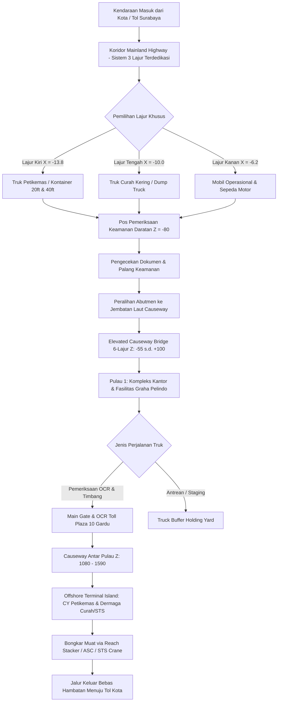
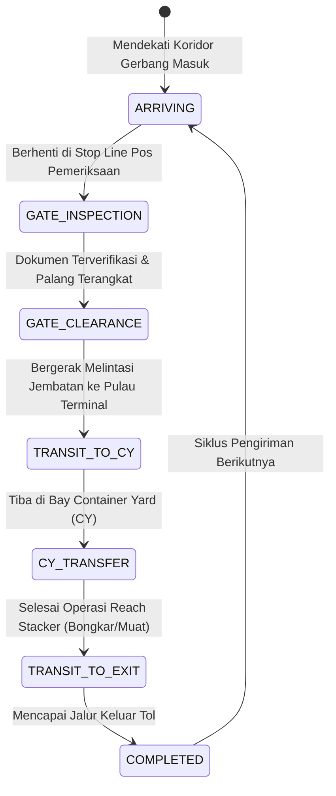
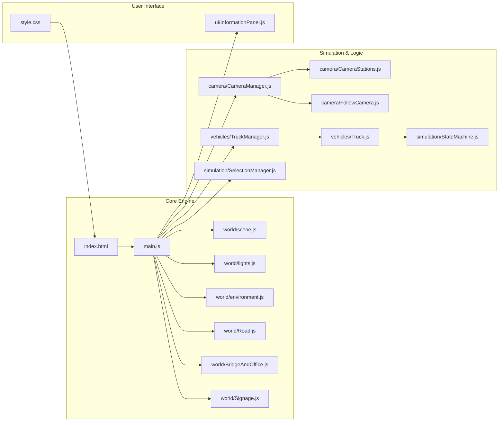

# 🏗️ Terminal Teluk Lamong (TTL) 3D Operation & Corridor Simulator

[](https://threejs.org/)
[](https://vitejs.dev/)
[](https://developer.mozilla.org/)
[](LICENSE)
[]()

---

## 📑 Daftar Isi
1. [Definisi Proyek](#1-definisi-proyek)
2. [Tujuan Proyek](#2-tujuan-proyek)
3. [Stack Teknologi](#3-stack-teknologi)
4. [Alur dan Arsitektur Sistem (Flow)](#4-alur-dan-arsitektur-sistem-flow)
   - [4.1 Alur Logistik & Operasional Lapangan](#41-alur-logistik--operasional-lapangan)
   - [4.2 Siklus Hidup Truk (State Machine)](#42-siklus-hidup-truk-state-machine)
   - [4.3 Arsitektur Teknis Sistem](#43-arsitektur-teknis-sistem)
5. [Hasil dan Fitur yang Dibangun](#5-hasil-dan-fitur-yang-dibangun)
6. [Struktur Direktori](#6-struktur-direktori)
7. [Cara Penggunaan](#7-cara-penggunaan)
   - [Prasyarat](#prasyarat)
   - [Instalasi](#instalasi)
   - [Menjalankan Aplikasi](#menjalankan-aplikasi)
   - [Panduan Kontrol Navigasi](#panduan-kontrol-navigasi)

---

## 1. Definisi Proyek

**Terminal Teluk Lamong (TTL) 3D Operation & Corridor Simulator** adalah aplikasi simulasi web 3D interaktif berbasis WebGL dan Three.js yang merepresentasikan koridor akses operasional dan infrastruktur **Terminal Teluk Lamong (PT Pelindo)** di Surabaya, Jawa Timur, Indonesia.

Terminal Teluk Lamong dikenal sebagai pelabuhan berkonsep *green and smart port* semi-otomatis pertama di Indonesia dengan letak terminal lepas pantai (*offshore terminal*) yang dihubungkan melalui jalan layang/jembatan penghubung laut (*causeway bridge*) sepanjang beberapa kilometer dari daratan utama (*mainland*).

Simulator ini memodelkan secara presisi:
- **Koridor Akses Daratan (*Mainland Highway*)**: Sistem jalan raya 3 lajur terdedikasi per arah (Lajur Kontainer, Lajur Curah Kering, Lajur Kendaraan Pribadi/Operasional) dengan aturan lalu lintas kiri Indonesia (*Left-Hand Traffic*).
- **Pos Pemeriksaan Keamanan (*Security Checkpoint*)**: Kanopi baja, gardu inspeksi, dan palang pembatas di daratan.
- **Ekosistem Pesisir**: Tambak perikanan (*aquaculture ponds*), tanggul tanah, estuari berlumpur intertidal, dan vegetasi bakau (*mangrove*).
- **Jembatan Laut Penghubung (*Sea Causeway Bridge*)**: Jalur layang 6 lajur dengan pilar pancang bawah air, pipa konveyor tertutup curah kering (*enclosed dry-bulk conveyor pipeline*), dan penerangan jalan ganda.
- **Kompleks Pulau Perkantoran (*Pulau 1 - Administrative & Operational Complex*)**: Gedung Graha Pelindo 4 lantai, kanopi drop-off, Masjid TTL berkubah putih, fasilitas olahraga & shelter parkir, area tunggu truk (*truck buffer holding yard*), serta gerbang tol inter-island 10 gardu dengan kanopi *barrel-vault* 50 meter.
- **Mesin Operasional**: Simulasi interaksi alat berat petikemas (*Reach Stacker*), truk semi-trailer setir kanan (*Right-Hand Drive*), serta panel kendali observasi interaktif (*Head-Up Display*).

---

## 2. Tujuan Proyek

Proyek ini dibangun untuk memenuhi beberapa tujuan strategis:

1. **Digital Twin & Visualisasi 3D Interaktif**:
   Menghadirkan replika visual digital interaktif dari lanskap fisik dan alur logistik Terminal Teluk Lamong yang dapat diakses langsung melalui peramban web modern tanpa instalasi perangkat lunak tambahan.
2. **Validasi Alur Lalu Lintas & Tata Letak (*Layout & Traffic Validation*)**:
   Mengevaluasi efektivitas sistem 3 lajur khusus terdedikasi, kapasitas antrean di pos keamanan sebelum jembatan laut, serta pergerakan kendaraan di area buffer (*holding yard*).
3. **Media Edukasi, Pelatihan, & Presentasi Stakeholder**:
   Memberikan pemahaman komprehensif bagi operator pelabuhan, pengemudi armada logistik, dispatcher, dan mahasiswa magang mengenai zonasi pelabuhan, prosedur gerbang OCR, serta aspek keselamatan operasional.
4. **Dasar Pengembangan Sistem Simulasi Cerdas Terpadu**:
   Menjadi fondasi untuk mengintegrasikan data IoT pelabuhan secara *real-time* (seperti posisi GPS armada, status gerbang otomatis, dan jadwal sandar kapal).

---

## 3. Stack Teknologi

| Komponen | Teknologi | Keterangan |
| :--- | :--- | :--- |
| **3D Graphics Engine** | [Three.js](https://threejs.org/) (`v0.185.1`) | Render grafis 3D WebGL, pencahayaan PBR, sistem bayangan *PCF Soft Shadows*, dan matriks kamera. |
| **Build Tool & Dev Server** | [Vite](https://vitejs.dev/) (`v8.2.0`) | Bundler modern berbasis ES Modules untuk *Fast HMR (Hot Module Replacement)* dan build produksi optimal. |
| **Programming Language** | JavaScript (ES6+ / ESM) | Logika modular untuk simulasi kendaraan, state machine, kalkulasi posisi waypoints, dan interaksi kanvas. |
| **Styling & HUD UI** | Vanilla CSS3 | Desain panel antarmuka *dark-mode glassmorphism*, tipografi sistematis, tata letak responsif, dan panel *collapsible*. |
| **Interactive Controls** | Three.js `OrbitControls` & Custom Input | Navigasi mouse orbit/pan/zoom dengan pembatasan sudut horizon (*ground clipping protection*) serta kontrol keyboard *WASD / QE / Zoom*. |
| **Procedural Generation** | HTML5 2D Canvas Context | Generator tekstur prosedural berbasis canvas untuk papan penunjuk arah kayu (*Entry/Exit signboards*), marka jalan, dan logo. |
| **Persistence** | Browser `sessionStorage` | Menyimpan sudut dan posisi kamera pengguna secara otomatis antar *reload* browser. |

---

## 4. Alur dan Arsitektur Sistem (Flow)

### 4.1 Alur Logistik & Operasional Lapangan

Alur pergerakan logistik kendaraan yang disimulasikan dari akses daratan hingga area operasional:



---

### 4.2 Siklus Hidup Truk (State Machine)

Kendaraan logistik dikendalikan oleh modul [StateMachine.js](file:///src/simulation/StateMachine.js) yang mengatur tahapan operasional secara otomatis:



---

### 4.3 Arsitektur Teknis Sistem



---

## 5. Hasil dan Fitur yang Dibangun

### A. Lingkungan 3D (*Mainland to Causeway Island*)
- **Jalan Tol 3 Lajur Khusus (Left-Hand Traffic)**: Marka termoplastik putih, marka kuning pulau tengah, chevron/hatch lines, panah pengarah vektor tajam.
- **Pos Pemeriksaan Daratan (*Security Checkpoint*)**: Kanopi baja terintegrasi, pos jaga inspektur, stop line aspal, dan palang otomatis.
- **Lanskap Pesisir Estuari**: Air tambak tenang, tanggul pematang tambak bertingkat, air laut estuari berpartikel silt dengan efek transparansi, serta barisan pohon bakau (*mangrove*).
- **Causeway Bridge Melengkung (680m)**: Tiang pancang beton maritim (*pile caps*), dek beton tebal 32m, pagar pengaman (*crash barrier*), dan pipa konveyor curah kering terisolasi di sisi timur.
- **Pulau 1 (Administrative & Operations)**:
  - Gedung **Graha Pelindo** modern 4 lantai dengan kaca reflektif, kanopi drop-off, tiang antena radio komunikasi, panel surya, serta logo berpendar.
  - **Masjid Terminal Teluk Lamong** dengan kubah putih monumental dan menara azan.
  - Lapangan olahraga (basket/futsal), taman lanskap palem, dan shelter kanopi parkir motor pegawai.
  - **Main Gate OCR**: Portal toll inspeksi berkanopi lebar dengan tiang baja dan rambu gantry.
  - **Truck Buffer Holding Yard**: Area parkir antrean truk dengan tumpukan petikemas multi-warna (*Evergreen, Maersk, CMA CGM, Hapag-Lloyd*).
  - **Inter-Island Toll Plaza**: Struktur kanopi melengkung *barrel-vault* sepanjang 50 meter dengan 10 gardu tol.

### B. Kontrol Kamera Multi-Vantage & Fleksibel
- **Preset Stasiun Pengamatan (*15+ Kamera Preset*)**:
  - `OVERVIEW`: Tampilan makro satelit dari daratan hingga pulau kantor.
  - `HIGHWAY`: Sudut pandang pengemudi di atas aspal jalan masuk (*Z = -320*).
  - `CHECKPOINT`: Sudut pandang pos pemeriksaan keamanan & kanopi (*Z = -186*).
  - `MEDIAN_PARK`: Area putar balik dan pulau median hijau.
  - `CAUSEWAY`: Jembatan layang melengkung di atas laut.
  - `HEAD_OFFICE`, `MASJID`, `SPORTS_COURT`: Fasilitas Pulau 1.
  - `MAIN_GATE`, `WAITING_AREA`: Area gerbang OCR dan buffer antrean kontainer.
  - `TOLL_PLAZA_VIEW`, `LOGISTICS_INTERSECTION_VIEW`, `MANGROVE_RESERVE_VIEW`: Koridor causeway antar-pulau.
- **Free Orbit & Protection Constraints**: Pengguna bebas memutar, menggeser, dan memperbesar sudut pandang tanpa khawatir kamera menembus tanah atau terbalik di bawah horizon.
- **Camera State Persistence**: Posisi dan target kamera tersimpan otomatis ke `sessionStorage` sehingga sudut observasi tidak hilang saat merefresh halaman.

### C. Antarmuka HUD (*Head-Up Display*) Modern
- **Panel Header Lipat (*Collapsible Header*)**: Menampilkan identitas pelabuhan dan petunjuk sistem lajur.
- **Operational Intelligence Dashboard**: Memberikan informasi spesifikasi infrastruktur, tipe muatan per lajur, dan telemetri lokasi.
- **Controls Hint Panel**: Panduan interaktif pintasan keyboard dan tombol reset posisi instan.

---

## 6. Struktur Direktori

```text
terminal-simulator/
├── index.html                  # Dokumen utama dan elemen UI overlay HUD
├── package.json                # Dependensi proyek (Three.js & Vite)
├── public/                     # Aset statis publik
│   ├── favicon.svg             # Favicon aplikasi
│   ├── icons.svg               # Koleksi ikon SVG
│   └── references/             # Dokumentasi citra satelit dan foto referensi TTL
└── src/                        # Kode sumber aplikasi
    ├── main.js                 # Entry point: inisialisasi scene, loop animasi, dan event listener
    ├── style.css               # Desain tata letak, glassmorphism HUD, dan animasi UI
    ├── camera/                 # Modul kontrol dan sistem kamera
    │   ├── CameraManager.js    # Pengendali utama kamera, transisi halus, keyboard & penyimpanan state
    │   ├── CameraStations.js   # Konfigurasi preset sudut pandang (Overview, Pos, Jembatan, Kantor, dll.)
    │   └── FollowCamera.js     # Kontrol kamera dinamis untuk melacak pergerakan kendaraan
    ├── equipment/              # Model alat berat pelabuhan
    │   └── ReachStacker.js     # Model 3D dan animasi teleskopik alat angkat Reach Stacker
    ├── simulation/             # Logika seleksi objek dan state machine
    │   ├── SelectionManager.js # Raycaster untuk klik dan seleksi objek 3D pada kanvas
    │   └── StateMachine.js     # State machine siklus operasional truk kontainer
    ├── ui/                     # Komponen antarmuka pengguna
    │   └── InformationPanel.js # Kontrol tab dan pembaruan telemetri dashboard HUD
    ├── vehicles/               # Model dan manajemen armada kendaraan
    │   ├── Truck.js            # Model 3D truk kontainer setir kanan (RHD) dan roda berputar
    │   └── TruckManager.js     # Pengelola armada dan navigasi waypoint kendaraan
    └── world/                  # Konstruksi lingkungan dan fasilitas 3D
        ├── BridgeAndOffice.js  # Jembatan laut, Graha Pelindo, Masjid, Gerbang Tol, & Plaza Logistik
        ├── environment.js      # Tambak, tanggul tanah, air laut estuari, dan pulau mangrove
        ├── Gate.js             # Model gantry gate, palang otomatis, dan lampu sinyal
        ├── lights.js           # Pengaturan pencahayaan matahari, hemisphere, dan bayangan
        ├── Road.js             # Jaringan jalan tol 3 lajur terdedikasi, marka aspal, & pulau median
        ├── scene.js            # Inisialisasi THREE.Scene, PerspectiveCamera, Renderer, & OrbitControls
        └── Signage.js          # Papan penunjuk arah kayu prosedural ENTRY/EXIT
```

---

## 7. Cara Penggunaan

### Prasyarat
Pastikan komputer Anda telah terpasang:
- **Node.js** (versi 18.0.0 atau lebih baru)
- **npm** (biasanya terpasang otomatis bersama Node.js)
- Peramban web modern dengan dukungan **WebGL 2.0** (Google Chrome, Microsoft Edge, Firefox, atau Safari).

### Instalasi

1. Buka terminal atau command prompt pada komputer Anda.
2. Masuk ke direktori proyek:
   ```bash
   cd "terminal-simulator"
   ```
3. Pasang seluruh dependensi proyek:
   ```bash
   npm install
   ```

### Menjalankan Aplikasi

#### 1. Mode Pengembangan (*Development Mode*)
Jalankan server lokal Vite dengan perintah:
```bash
npm run dev
```
Buka tautan lokal yang ditampilkan di terminal (biasanya `http://localhost:5173/` atau `http://localhost:5174/`) di browser Anda.

#### 2. Mode Produksi (*Production Build & Preview*)
Untuk melakukan kompilasi bundel produksi:
```bash
npm run build
npm run preview
```

---

### Panduan Kontrol Navigasi

Anda dapat mengontrol sudut pandang kamera dengan kombinasi mouse dan keyboard:

| Kontrol | Tindakan | Deskripsi |
| :--- | :--- | :--- |
| **Mouse Left Drag** | Orbit / Putar Kamera | Memutar sudut pandang observasi mengelilingi titik fokus. |
| **Mouse Right Drag** | Pan Kamera | Menggeser posisi pandang secara horizontal atau vertikal. |
| **Mouse Scroll** | Zoom In / Out | Mendekatkan atau menjauhkan kamera dari target. |
| **W / A / S / D** | Geser Kamera | Bergerak maju (`W`), mundur (`S`), geser ke kiri (`A`), atau ke kanan (`D`). |
| **Q / E** | Elevasi Vertikal | Menaikkan (`Q`) atau menurunkan (`E`) ketinggian kamera dari permukaan tanah. |
| **[ / ]** | Zoom Lensa (FOV) | Memperlebar (`]`) atau mempersempit (`[`) sudut pandang bidang penglihatan. |
| **Shift** (Ditahan) | Gerak Cepat (Sprint) | Melipatgandakan kecepatan gerak kamera hingga 3x lipat. |
| **Tombol `↺ Reset Posisi Kamera`** | Reset Kamera | Mengembalikan posisi kamera ke sudut pandang awal (*Overview*). |
| **Tombol `−` / `+` pada Panel HUD**| Lipat / Buka Panel | Menyembunyikan atau menampilkan rincian panel antarmuka HUD. |

---

## 👨‍💻 Kontributor & Pengembangan

Proyek ini dikembangkan sebagai bagian dari program simulasi dan visualisasi 3D operasional maritim di lingkungan **Terminal Teluk Lamong - PT Pelabuhan Indonesia (Persero) Sub Regional Jawa / Universitas Ciputra Surabaya**.
